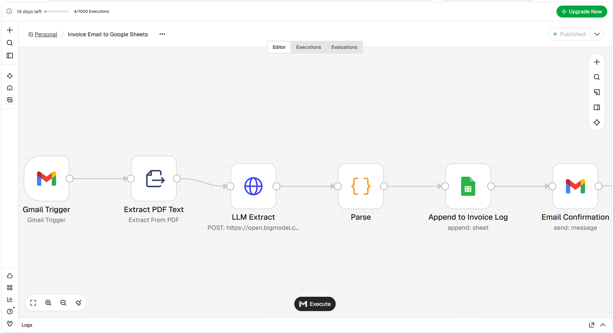
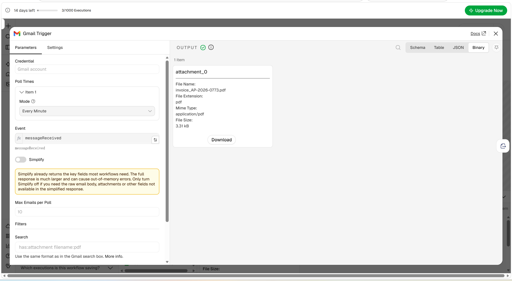
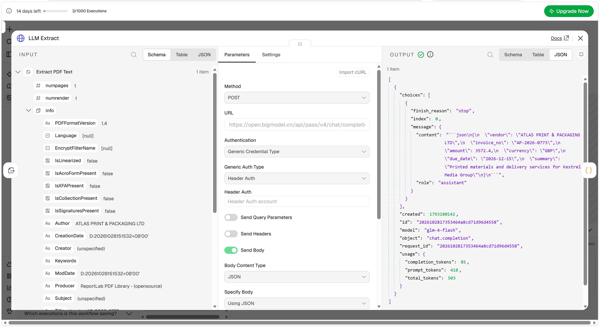
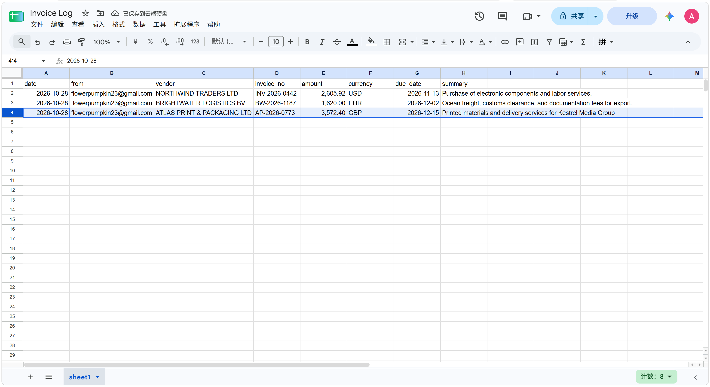
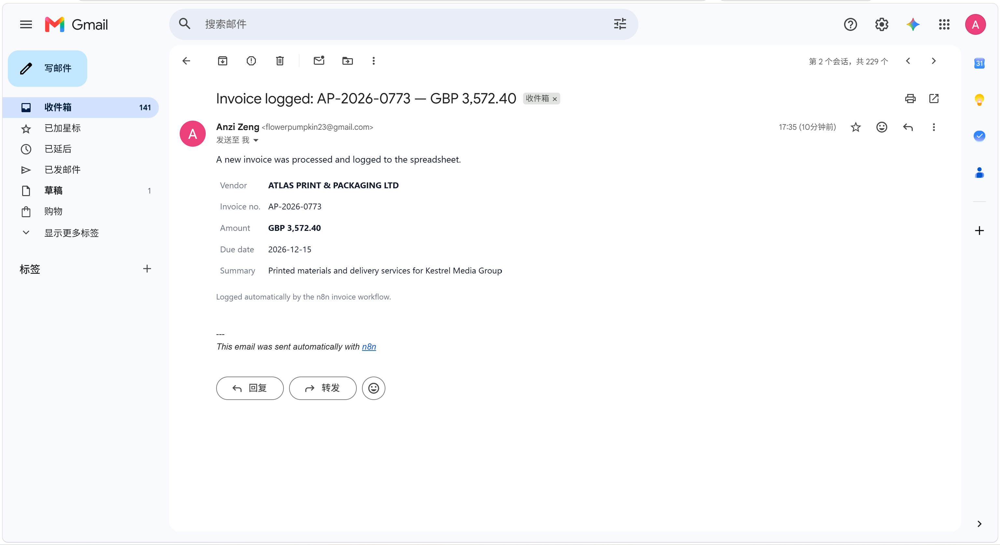

# Invoice Email → Google Sheets

An n8n workflow that watches a Gmail inbox for PDF invoices, extracts the key fields with an LLM, appends a row to Google Sheets, and emails a confirmation summary.

No manual data entry, no template per supplier — the model reads each invoice and returns the fields it actually contains.

```
Gmail Trigger → Extract PDF Text → LLM Extract → Parse → Append to Invoice Log → Email Confirmation
```



---

## What it does

1. **Gmail Trigger** polls the inbox every minute. The Gmail search query `has:attachment filename:pdf` limits it to PDF attachments, so ordinary mail is never fetched.
2. **Extract PDF Text** converts the PDF attachment into plain text.
3. **LLM Extract** posts that text to an OpenAI-compatible chat endpoint (in this build: Zhipu `glm-4-flash`) and asks for a single JSON object.
4. **Parse** strips any markdown fences the model adds, validates the JSON, pulls the sender from the raw message headers, and flattens everything into the eight columns of the sheet.
5. **Append to Invoice Log** adds one row.
6. **Email Confirmation** sends an HTML summary back to the mailbox owner.

Every run appears in n8n's **Executions** view with per-node input and output, so a wrong value can be traced to the exact step that produced it.

---

## The eight columns

| Column | Example | Source |
|---|---|---|
| `date` | `2026-10-28` | date the workflow ran (Beijing time) |
| `from` | `flowerpumpkin23@gmail.com` | `From:` header of the email |
| `vendor` | `NORTHWIND TRADERS LTD` | LLM |
| `invoice_no` | `INV-2026-0442` | LLM |
| `amount` | `2605.92` | LLM — total amount due, number only |
| `currency` | `USD` | LLM — ISO 4217 code |
| `due_date` | `2026-11-13` | LLM — normalised to ISO |
| `summary` | `Purchase of electronic components and labor services.` | LLM — one sentence |

The sheet must have these exact names in row 1. The Sheets node runs in **Map Automatically** mode, which matches input keys to column headers by name — rename a column and you must rename the matching key in the Parse node.

---

## Setup

1. Import `workflow.json` into your n8n instance (**Workflow menu → Import from File**).
2. Create a Google Sheet with the eight headers above. Copy the ID from its URL — the string between `/d/` and `/edit`.
3. Open **Append to Invoice Log** and replace `REPLACE_WITH_YOUR_SHEET_ID` with your ID, then pick the sheet tab from the dropdown.
4. Connect credentials — each of these nodes needs one:
   - **Gmail Trigger** and **Email Confirmation**: a Gmail OAuth2 credential
   - **Append to Invoice Log**: a Google Sheets OAuth2 credential
   - **LLM Extract**: a **Header Auth** credential with name `Authorization` and value `Bearer <your-api-key>`
5. Open **Email Confirmation** and replace `you@example.com` with your address.
6. Publish (activate) the workflow.

> On n8n Cloud the Google credentials are covered by managed OAuth — click **Sign in with Google** and you are done. On a self-hosted instance you must create your own Google Cloud project, enable the Gmail and Sheets APIs, and register an OAuth client with the redirect URI `http://<your-host>/rest/oauth2-credential/callback`.

### Why the API key goes in a credential, not in the node

The key is held in an n8n **Header Auth** credential. The exported workflow contains only the credential's *name*, never the secret — so this file is safe to publish. If you paste the key directly into the HTTP Request node's headers, it ends up in plain text in every export of the workflow.

---

## Swapping the model

**LLM Extract** is a plain HTTP Request node pointed at an OpenAI-compatible endpoint, so the provider is a three-line change: `url`, `model`, and the credential.

| Provider | URL | model |
|---|---|---|
| Zhipu (this build) | `https://open.bigmodel.cn/api/paas/v4/chat/completions` | `glm-4-flash` |
| OpenAI | `https://api.openai.com/v1/chat/completions` | `gpt-4o-mini` |
| DeepSeek | `https://api.deepseek.com/chat/completions` | `deepseek-chat` |
| Local (Ollama) | `http://localhost:11434/v1/chat/completions` | `qwen2.5:7b` |

The extraction prompt is in the same node. To add a field, add it to the prompt's key list and to the Parse node's output object, then add the column to the sheet.

---

## Screenshots

**Gmail Trigger** — the search query limits it to PDF attachments; the PDF arrives as binary `attachment_0`.



**LLM Extract** — the model returns one JSON object, which the next node parses.



**Append to Invoice Log** — three invoices, three suppliers, three currencies, one sheet.



**Email Confirmation** — the loop closes with a summary of what was written.



---

## Limitations

Stated plainly, because these are the questions a buyer will ask:

- **No duplicate detection.** The same invoice forwarded twice produces two rows. Fixing this means looking up `invoice_no` before appending — a `Get row(s)` node plus an `If` branch.
- **Text-layer PDFs only.** A scanned invoice has no text layer; this build does not do OCR. Such a message fails at *Extract PDF Text*.
- **One attachment per email.** The workflow reads `attachment_0`. An email with two invoices needs a Split In Batches loop.
- **Polling, not instant.** The trigger checks once a minute, so there is up to 60 seconds of latency.
- **No error workflow.** A failed execution is visible in the Executions tab but nobody is notified. An error workflow is the obvious next addition.

---

## Sample data

Everything in `samples/` is fictional, generated by `scripts/make_invoice_pdf.py` (ReportLab). Three suppliers, three currencies, three different tax treatments:

| File | Supplier → Client | Number | Total |
|---|---|---|---|
| `invoice_NW-2026-0442.pdf` | Northwind Traders Ltd → Halden Instrumentation GmbH | `INV-2026-0442` | 2,605.92 USD |
| `invoice_BW-2026-1187.pdf` | Brightwater Logistics BV → Meridian Retail Group AG | `BW-2026-1187` | 1,620.00 EUR |
| `invoice_AP-2026-0773.pdf` | Atlas Print & Packaging Ltd → Kestrel Media Group | `AP-2026-0773` | 3,572.40 GBP |

To regenerate:

```bash
pip install reportlab
python scripts/make_invoice_pdf.py
```
